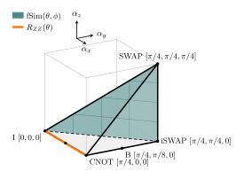

# weyl-circuit-compression

Repository accompanying the paper "Exploiting the Weyl-Chamber Structure for Hardware-Aware Quantum
Circuit Compression" by Neel Misciasci, Isabel Nha Minh Le, and Christian B. Mendl.

Trotterized time-evolution circuits for 1D spin chains are compressed by optimizing them against a
reference propagator stored as a matrix product operator (MPO). Gradients with respect to each gate
are obtained by tensor-network contraction of the gate environment. Two approaches are compared:

- **Riemannian optimization (RO)**: generic two-qubit gates in a brickwall circuit, optimized with
  Riemannian Adam on the unitary manifold (as in [rqcopt-mpo](https://github.com/INMLe/rqcopt-mpo)).
- **Hardware-aware parameterized optimization (PO)**: native two-qubit gates ($R_{ZZ}$ for the Ising
  model, fSim for the XXZ Heisenberg model) optimized through their angles with Adam (chain rule on the
  gate-matrix gradient); single-qubit gates are optimized with Riemannian Adam.

<p align="center">
  
</p>

*Weyl chamber $\pi/4 \ge \alpha_x \ge \alpha_y \ge \alpha_z \ge 0$ of two-qubit gates up to local
equivalence. The native gate families used here are highlighted: $R_{ZZ}(\theta)$ lies on the
I–CNOT edge (orange), and $\mathrm{fSim}(\theta,\phi)$ covers the face $\alpha_x = \alpha_y$
(I–iSWAP–SWAP, teal).*

## Installation

The environment used for the paper results is given in `requirements.txt` (Python 3.12, CPU):

```bash
python3 -m venv <env>
source <env>/bin/activate
pip install -r requirements.txt
pip install -e .        # installs the package weyl_compression from this repository
pytest                  # optional: unit tests in pytests/
```

## Repository structure

| Folder | Content |
|---|---|
| `weyl_compression/` | Python package. Trotter splittings of the paper in `circuit/trotter/`: `even_odd.py` (RO ansatz and reference U_ref), `hardware_aware_ising.py` and `hardware_aware_heisenberg.py` (PO ansatz), `field_middle.py`. Native-gate parameterization in `circuit/native_gates/` (`rzz.py`, `fsim.py`). Optimizers: `optimization/riemannian_adam/optimizer.py` (`optimize_riemannian`, RO) and `optimization/hardware_aware/` (`optimize_rzz`, `optimize_fsim`, PO). Gate environments and overlap in `optimization/gradient.py`, HST loss in `optimization/utils.py`. `experiment.py` holds the shared experiment set-up (configs, initial circuits, loss evaluation, run files). |
| `run/` | `generate-reference.py` (reference MPO), `run-optimization.py` (RO or PO), and per-model configurations in `run/<model>/configs/`. References and results are written to `run/<model>/reference/` and `run/<model>/results/`. |
| `trotterization/` | Scripts evaluating unoptimized Trotter circuits: spectral error of the Trotter splittings (exact, N=10) and the loss of the initial circuits against the reference MPO. |
| `plotting-results/` | `data/`: the numerical data shown in the paper (`.pkl`, the Trotter-splitting `.csv`, and the two run files behind the Weyl-coordinate figures); `plotting-results.py`: generates all figures into `gfx/`. |
| `pytests/` | Unit tests. |

## Running the optimizations

The configurations in `run/<model>/configs/*.yml` (with `<model>` = `ising` or `heisenberg` and
method `riemannian` or `hardware-aware`) are small examples with N=10 sites that run within a few minutes
on a CPU. From the `run/` folder:

```bash
python generate-reference.py ising/configs/riemannian.yml       # one reference per model and size
python run-optimization.py ising/configs/riemannian.yml
python run-optimization.py ising/configs/hardware-aware.yml --reps 12 --max-steps 100
```

`--reps` sets the number of second-order Trotter repetitions of the initial circuit and `--max-steps`
the number of optimization steps. Each run is saved as a pickled dictionary, `.pkl` (loss history,
optimized circuit, full configuration, reference file and its SHA-256, package versions); reference
MPOs are saved as `.pkl` as well.

The loss of the unoptimized Trotter circuits (dashed curves in the comparison figures) is computed by

```bash
python ../trotterization/initial-trotter-loss.py ising/configs/hardware-aware.yml --reps 3 6 9 12
```

## Paper settings (N = 50)

The configurations in `run/<model>/configs/paper/` contain the settings of the paper (N=50); each data
point is one run with `--reps r`. Ising model: $J=1$, $h=0.75$, $g=0.6$, $t=2$; XXZ Heisenberg model:
$J=1$, $J_z=-0.5$, $h=0.75$, $t=0.25$. A single optimization step at N=50 takes on the order of seconds
per circuit layer on a CPU, so the full runs are long jobs (hours to days).

| | Ising | Heisenberg |
|---|---|---|
| Reference MPO | 4th-order Suzuki-Trotter, 20 steps, bond dimension 64 | 4th-order Suzuki-Trotter, 10 steps, bond dimension ≤ 128, compressed at 1e-10 (to 81) |
| RO points (r) | 1, 2, 3, 4, 6, 7, 8 | 1, …, 8 |
| PO points (r) | 3, 6, 9, 12, 18, 21, 24 | 2, 3, 5, 6, 7, 8, 10, 11 |


## Figures

`python plotting-results/plotting-results.py` reproduces all data figures of the paper in
`plotting-results/gfx/` from `plotting-results/data/`:
- the two Riemannian optimization runs (N=50, 7 Trotter repetitions; run files as written by the
  optimization, including the optimized circuits) from which the Weyl coordinates of the optimized gates
  are computed with qiskit's KAK decomposition;
- loss vs. native depth for both models and the Riemannian Adam loss history as `.pkl` files (Python
  dictionaries; load with `pickle.load`);
- the Trotter-splitting errors as a `.csv` file produced by `trotterization/compare-trotter-splits.py`.

The degrees-of-freedom figure is computed from closed-form gate counts.

## Acknowledgments

The tensor-network contractions and the Riemannian optimization follow
I. N. M. Le, S. Sun, and C. B. Mendl, Riemannian quantum circuit optimization based on matrix product
operators, [Quantum 9, 1833 (2025)](https://doi.org/10.22331/q-2025-08-27-1833),
with code at [INMLe/rqcopt-mpo](https://github.com/INMLe/rqcopt-mpo).
All tensor-network operations are implemented with `jax.numpy`.

## License

This code is released under the MIT License (see `LICENSE`).
